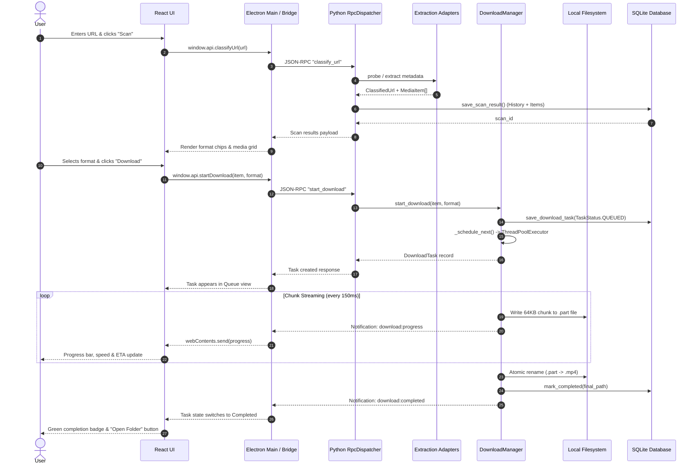

# XakuMedia — System Architecture

## 1. Architectural Style & High-Level System Structure

XakuMedia is architected as a **secure three-tier desktop application** enforcing strict process isolation, local-first data ownership, and clean separation of concerns.

The three primary runtime layers are:
1. **Frontend Presentation Layer (Renderer):** A sandboxed Chromium renderer running a modern Single Page Application (SPA) built with React 18, TypeScript, Vite, and Tailwind CSS.
2. **Desktop Shell & Process Coordinator (Main Process):** An Electron runtime (Node.js) acting as an unprivileged host, security enforcer, window lifecycle manager, native dialog provider, and message broker.
3. **Backend Computational Engine (Python 3.12 Process):** An independent Python background child process performing all network I/O, URL parsing, media extraction, chunked file streaming, SQLite database transactions, and FFmpeg stream multiplexing.

### Interactive System Architecture Diagram
> An interactive visual architecture diagram generated via Archify is available at:  
> [xakumedia-architecture.html](file:///d:/Project/Personal/System/XakuMedia/.archify/architecture-xakumedia-20261111-110800/xakumedia-architecture.html)

### System Component Architecture (Mermaid)

```mermaid
flowchart TB
    subgraph Frontend["Chromium Renderer (Sandboxed)"]
        UI["React 18 SPA (App.tsx / main.tsx)"]
        Views["Views: Scan | Queue | Library | Saved | History | Settings"]
        PlayerLightbox["In-App Player & Image Lightbox"]
        ThemeEngine["Dual-Theme Engine (Light / Dark)"]
    end

    subgraph DesktopShell["Electron Desktop Shell (Node.js)"]
        Preload["Preload Bridge (desktop/preload/index.ts)<br/>window.api (contextIsolation: true)"]
        Main["Electron Main Process (desktop/main/index.ts)<br/>Lifecycle & Security Headers (CSP)"]
        PyBridge["PythonBridge (desktop/main/python-bridge.ts)<br/>ChildProcess Supervisor & JSON-RPC Client"]
        MediaLoader["Custom Scheme: media-loader://<br/>HTTP 206 Streaming Protocol Handler"]
    end

    subgraph PythonEngine["Python 3.12 Backend Engine (Child Process)"]
        RpcLoop["Stdio Event Loop (server/loop.py)<br/>JSON-RPC 2.0 Framing & Thread Locks"]
        Dispatcher["RpcDispatcher (server/dispatcher.py)<br/>40+ Method Handlers"]
        
        subgraph Subsystems["Core Engine Subsystems"]
            Scanner["Direct Scanner (scanners/direct.py)<br/>HEAD / Range GET Prober"]
            ExtVideo["Video Extractor (extractors/video.py)<br/>yt-dlp Format Normalizer"]
            ExtGallery["Gallery Extractor (extractors/gallery.py)<br/>gallery-dl DataJob Engine"]
            Downloader["DownloadManager (downloader/manager.py)<br/>ThreadPoolExecutor & Multi-Slot Scheduler"]
            Throttler["BandwidthThrottler (downloader/throttler.py)<br/>Thread-Safe Token Bucket Rate Limiter"]
            Streamer["Stream Downloader (downloader/stream.py)<br/>64KB Buffer, Range Resumption & .part Staging"]
            Recovery["TaskRecoveryService (downloader/recovery.py)<br/>Startup Crash Audit & Auto-Resumption"]
            Processor["FFmpeg Processor (processor/ffmpeg.py)<br/>Stream Multiplexing (-c copy) & Media Inspection"]
            Thumbnail["Thumbnail Engine (processor/thumbnail.py)<br/>Pillow & FFmpeg WebP Caching"]
            AuthEngine["Auth & Cookie Engine (auth/)<br/>Netscape Parser & DPAPI Browser Decryption"]
            Rescan["Differential Rescan (sources/rescan.py)<br/>O(1) Set Diffing for Saved Sources"]
            SecurityUtil["Security Utilities (utils/)<br/>SSRF Parser, NTFS ADS & Traversal Defense"]
        end

        Repo["MediaRepository (db/repository.py)<br/>SQLite Transactions & Batch Operations"]
        Schema["Schema Engine (db/schema.py)<br/>Migrations V1 to V4 (WAL Mode)"]
    end

    subgraph LocalStorage["Local Host Filesystem & Storage"]
        SQLiteDB[("SQLite 3 Database<br/>%LOCALAPPDATA%/XakuMedia/db/xakumedia.db")]
        DiskMedia["Local Media Directory<br/>{UserChosenDir}/videos/ & /images/"]
        ThumbCache["Thumbnail Disk Cache<br/>%LOCALAPPDATA%/XakuMedia/cache/thumbnails/"]
        CookieFiles["Sanitized Cookie Files<br/>%LOCALAPPDATA%/XakuMedia/auth/cookies/"]
    end

    subgraph External["External Network / Web Sources"]
        DirectURLs["Direct Media Hosts (CDNs)"]
        VideoPlatforms["Video Platforms (YouTube, Twitter/X, etc.)"]
        GalleryHosts["Gallery & Art Platforms (Reddit, Imgur, etc.)"]
    end

    %% Interactions
    UI -->|IPC invoke| Preload
    Preload -->|ipcRenderer.invoke| Main
    Main -->|sendRequest| PyBridge
    PyBridge <-->|stdin / stdout line-delimited JSON-RPC 2.0| RpcLoop
    RpcLoop --> Dispatcher
    
    Dispatcher --> Scanner
    Dispatcher --> ExtVideo
    Dispatcher --> ExtGallery
    Dispatcher --> Downloader
    Dispatcher --> Processor
    Dispatcher --> Thumbnail
    Dispatcher --> AuthEngine
    Dispatcher --> Rescan
    Dispatcher --> Repo

    Scanner --> SecurityUtil
    Scanner -->|HTTP HEAD / Range GET| DirectURLs
    ExtVideo -->|Extract Metadata| VideoPlatforms
    ExtGallery -->|DataJob Extract| GalleryHosts

    Downloader --> Throttler
    Downloader --> Streamer
    Streamer --> SecurityUtil
    Streamer -->|HTTP Range GET Stream| DirectURLs
    Streamer -->|Atomic .part write & rename| DiskMedia
    
    Downloader -.->|Dual-track merge| Processor
    Processor -->|Stream copy / AAC fallback| DiskMedia
    
    Repo --> Schema
    Schema --> SQLiteDB
    Repo --> SQLiteDB
    
    Thumbnail --> ThumbCache
    AuthEngine --> CookieFiles
    
    %% Notifications & Streaming
    RpcLoop -.->|JSON-RPC Notifications<br/>download:progress, download:completed| PyBridge
    PyBridge -.->|webContents.send| UI
    
    PlayerLightbox -->|media-loader://path?path=...| MediaLoader
    MediaLoader -->|net.fetch file:// 206 Partial Content| DiskMedia
```



---

## 2. Process Boundaries & Security Architecture

### 2.1 Frontend (Chromium Renderer)
- **Zero Node.js Privileges:** Configured with `nodeIntegration: false` and `contextIsolation: true`. The renderer cannot require native modules, execute shell commands, read arbitrary files, or establish raw database sockets.
- **Strict Content Security Policy (CSP):** Enforced via HTTP response headers (`session.defaultSession.webRequest.onHeadersReceived` in `desktop/main/index.ts`):
  ```http
  default-src 'self';
  script-src 'self';
  style-src 'self' 'unsafe-inline';
  img-src 'self' data: https: blob: media-loader:;
  media-src 'self' data: https: blob: media-loader:;
  font-src 'self' data:;
  connect-src 'self' ws://localhost:5173 http://localhost:5173;
  object-src 'none';
  base-uri 'self';
  form-action 'self';
  frame-ancestors 'none';
  ```
- **Navigation Lockdown:** All window open attempts are blocked via `setWindowOpenHandler({ action: "deny" })`. Navigation away from the application origin is intercepted and cancelled via `webContents.on("will-navigate")`.

### 2.2 Desktop Shell (Main Process)
- **Message Broker:** Coordinates IPC messages between the React frontend and the Python backend. Validates inputs before delegating them to the Python process.
- **Process Supervisor:** Manages the lifecycle of the Python background engine (`pythonBridge.start()` and `pythonBridge.stop()`), ensuring clean shutdown without leaving orphan or zombie processes.
- **Single-Instance Mutex:** Enforces `app.requestSingleInstanceLock()`. Secondary launches emit an explicit diagnostic message and focus the primary window instead of failing silently.
- **Privileged `media-loader://` Custom Scheme:**
  - Registered as privileged scheme (`standard: true, secure: true, supportFetchAPI: true, stream: true`).
  - Converts virtual media requests into streaming local file responses via `net.fetch(pathToFileURL(normalized).toString())`, natively supporting HTTP 206 Partial Content for instant video seeking.
  - Defense barriers: Rejects UNC paths (preventing SMB hash leaks), rejects NTFS Alternate Data Streams (`:`), requires absolute paths, and strictly enforces a file extension whitelist (`.mp4`, `.webm`, `.mkv`, `.jpg`, `.png`, `.webp`, etc.).

### 2.3 Python Engine (Backend)
- **Unprivileged Background Child Process:** Launched via `child_process.spawn` with `PYTHONUNBUFFERED=1` and `PYTHONIOENCODING=utf-8`.
- **Pure Stdio Communication:** Interacts exclusively through standard input (`stdin`) and standard output (`stdout`). Log messages are directed to standard error (`stderr`), preventing stream contamination.
- **Thread Safety:** Implements threading locks (`_stdout_lock` in `server/loop.py` and `_lock` in `downloader/manager.py`) to prevent interleaved JSON lines across parallel worker threads.

---

## 3. Communication Patterns

### 3.1 Synchronous Request-Response (JSON-RPC 2.0)
The standard query/mutation pattern follows the JSON-RPC 2.0 specification:
1. React UI invokes a typed method on `window.api` (e.g. `window.api.classifyUrl(url)`).
2. Electron preload script invokes `ipcRenderer.invoke("python:classifyUrl", url)`.
3. Electron main process forwards the request via `pythonBridge.sendRequest("classify_url", { url })`.
4. `PythonBridge` assigns an incremental integer `id`, records a pending `Promise`, serializes the payload, and writes to Python's `stdin`.
5. Python's `server/loop.py` reads the line, parses the JSON, and delegates to `RpcDispatcher`.
6. `RpcDispatcher` executes the handler, formats a success/error JSON-RPC response with matching `id`, and writes to `stdout`.
7. `PythonBridge` reads the response from `stdout`, resolves the corresponding pending `Promise`, and returns the result to `ipcMain`.
8. `ipcMain` returns the deserialized data to the React renderer.

```
React (Renderer)         Preload (window.api)      Main Process (Bridge)      Python Engine (Server)
      |                            |                          |                         |
      |-- classifyUrl(url) ------->|                          |                         |
      |                            |-- ipcRenderer.invoke --->|                         |
      |                            |                          |-- stdin: {"id":1,...} ->|
      |                            |                          |                         |-- execute handler
      |                            |                          |<- stdout: {"id":1,...} -|
      |                            |<-- Promise resolve ------|                         |
      |<-- Result returned --------|                          |                         |
```

### 3.2 Unidirectional Asynchronous Notifications
Background operations (download progress, completion, task pausing, queue clearing) emit unprompted events:
1. Python worker thread creates a `ProgressUpdate` or `DownloadTaskRecord`.
2. Python engine calls `_broadcast(event_name, payload)` which serializes a JSON-RPC notification (a message with `method` and `params`, but no `id`).
3. Message is written to Python's `stdout` under a thread lock.
4. `PythonBridge` detects a message lacking an `id`, recognizing it as an asynchronous notification.
5. `PythonBridge` triggers registered notification listeners, invoking `mainWindow.webContents.send(method, params)`.
6. Electron preload script catches the IPC event and executes the React subscriber callback (e.g., `onDownloadProgress`).

```
Python Worker Thread     Python Stdio Loop          PythonBridge (Main)       React UI (Renderer)
      |                          |                          |                         |
      |-- progress update ------>|                          |                         |
      |                          |-- stdout: {"method":...}-|                         |
      |                          |   (no "id" field)        |-- webContents.send ---->|
      |                          |                          |   "download:progress"   |-- update React state
```

### 3.3 Media Streaming via `media-loader://`
Local media preview uses Chromium's native streaming protocol capabilities:
1. React player or lightbox sets `<video src="media-loader://video?path=C%3A%5C...%5Cvideo.mp4">`.
2. Chromium network stack requests the URL from the registered `media-loader` protocol handler.
3. Handler performs security sanitization (UNC, ADS, extension whitelist).
4. Handler transforms the local file path into a file URL (`pathToFileURL`) and calls `net.fetch(fileUrl)`.
5. Electron handles HTTP Range headers (`Range: bytes=0-1048576`), returning HTTP 206 Partial Content streams.
6. The video element seeks instantly with smooth hardware acceleration.

---

## 4. Core Engine Subsystems

### 4.1 URL Classification & Extraction Adapters
XakuMedia uses an **Adapter Pattern** to isolate external source extraction from the application core:
- **Direct Resource Scanner (`scanners/direct.py`):** Fast probing of headers via HTTPX (`HEAD` with fallback to Range `GET 0-1024`). Resolves MIME types, file sizes, and Content-Disposition filenames.
- **Video Extractor (`extractors/video.py`):** Uses `yt-dlp` to extract video formats, resolutions, containers, and codecs. Identifies separate video and audio streams requiring FFmpeg multiplexing (`requires_merge`). Translates platform-specific errors to domain exceptions (`PrivateMediaError`, `RateLimitError`, `DRMProtectedError`, `MediaUnavailableError`).
- **Gallery Extractor (`extractors/gallery.py`):** Uses `gallery-dl` via `DataJob(file=None)` to extract multi-item image collections without writing to disk or polluting stdio. Normalizes items with sequential `#index` labels.
- **Unified Dispatcher (`server/dispatcher.py`):** Probes direct URLs first, then checks gallery-dl extractor matching, then attempts yt-dlp video extraction. Discovered items are automatically persisted to the SQLite `scan_history` and `media_items` tables.

### 4.2 Download Queue & Worker Thread Pool
- **Orchestration (`downloader/manager.py`):** Uses Python's `ThreadPoolExecutor(max_workers=30)` to manage active download workers.
- **Bounded Concurrency:** Concurrency is configurable from 1 to 10 active tasks (default 3). Waiting tasks reside in a thread-safe pending FIFO list (`_pending_queue`).
- **Slot Scheduling:** When an active worker finishes, pauses, or cancels, `_schedule_next()` automatically pops the next task and launches it on the thread pool.
- **Thread Coordination:** Each active task is paired with a `cancel_event` and `pause_event` (`threading.Event`). Setting an event interrupts the chunk streaming loop within 150ms.

### 4.3 Chunked Streaming Engine & HTTP Range Resumption
- **Streaming Buffer (`downloader/stream.py`):** Downloads data in 64 KB chunks (`CHUNK_SIZE = 65536`) via HTTPX with streaming enabled.
- **Two-Phase Atomic Commit:** Media is streamed to a temporary `.part` file (e.g. `video_001.mp4.part`). When download completes and integrity is verified, it is atomically renamed to the final destination (`video_001.mp4`).
- **Range Resumption:** If an existing `.part` file exists on disk, the engine inspects its size (`existing_bytes = temp_path.stat().st_size`) and sends `Range: bytes={existing_bytes}-`. The server returns HTTP 206 Partial Content, and the engine appends to the `.part` file (`open(temp_path, "ab")`).
- **HTTP 416 Handling:** If the server returns HTTP 416 (Range Not Satisfiable), indicating the file was already fully downloaded, the engine promotes the `.part` file to the final destination.

### 4.4 Token-Bucket Bandwidth Limiter
- **Architecture (`downloader/throttler.py`):** Implements a thread-safe token bucket rate limiter (`BandwidthThrottler`).
- **Micro-Sliced Sleeping:** Sleep intervals are sliced into chunks $\le 50\text{ ms}$, ensuring instant responsiveness when tasks are paused or cancelled during high rate limiting.
- **Global Quota Sharing:** All concurrent worker threads call `throttler.consume(chunk_size)` on the shared instance, guaranteeing total bandwidth remains strictly within the configured limit.

### 4.5 FFmpeg Stream Multiplexing & Format Conversion
- **Dynamic Binary Discovery (`processor/ffmpeg.py`):** Dynamically discovers `ffmpeg.exe` and `ffprobe.exe` across environment variables (`FFMPEG_PATH`), packaged application resources (`resources/bin/`), system `PATH`, and standard Windows paths (`C:\lib\ffmpeg...`, `WinGet\Links`, `Program Files`).
- **Lossless Multiplexing:** When high-resolution video streams are delivered with separate audio streams (common on modern platforms), `merge_video_audio` multiplexes them using stream copy mode (`-c:v copy -c:a copy`) to avoid lossy, CPU-intensive re-encoding.
- **Codec Fallback:** If merging into an MP4 container and the audio stream uses an incompatible codec (such as Opus), the engine transcodes only the audio track to AAC (`-c:a aac -b:a 192k`) while keeping the video track bit-exact.

### 4.6 Local SQLite Persistence & Migration Engine
- **Connection Management (`db/connection.py`):** Thread-safe connection manager operating in Write-Ahead Logging (`WAL`) mode with `foreign_keys = ON`, `busy_timeout = 10000`, and automatic transaction commits.
- **Repository Layer (`db/repository.py`):** High-throughput data access layer using SQLite `executemany` batch transactions for inserting large media collections ($<20\text{ ms}$ for 1,000 items).
- **Forward Migration Runner (`db/schema.py`):** Automated migration engine tracking versions via `schema_version` table (V1 to V4), self-healing missing columns, and ensuring schema consistency across updates.

### 4.7 Session Credentials & Cookie Management
- **Netscape Parser (`auth/cookies.py`):** Tab-delimited 7-field parser supporting `#HttpOnly_` prefixes and standard Netscape formats.
- **Browser DPAPI Extraction:** Leverages `yt-dlp`'s Windows DPAPI cookie extraction engine to extract cookies directly from local browser profiles (Chrome, Edge, Firefox, Brave, Opera, Vivaldi).
- **Subdomain Hierarchy Header Matching (`auth/headers.py`):** Resolves request headers with hierarchical fallback (e.g. `images.example.com` inherits custom authorization headers from `example.com`). Injected seamlessly into HTTPX, yt-dlp, and gallery-dl.

### 4.8 Task Queue Crash Recovery
- **Startup Audit (`downloader/recovery.py`):** Automatically invoked during Electron startup (`pythonBridge.start() -> recover_interrupted_tasks`).
- **Disk vs DB Reconciler:** Scans tasks marked `downloading`, `merging`, `scanning`, or `queued` against disk files:
  - If final destination file exists and is non-empty $\rightarrow$ marks `completed`.
  - If partial `.part` file exists $\rightarrow$ updates `bytes_downloaded` and marks `paused`.
  - If corrupted intermediate merge files (`.video.part`, `.audio.part`) exist $\rightarrow$ removes corrupted merge output and resets task to `paused`.
  - If `auto_start_downloads` preference is enabled $\rightarrow$ automatically re-enqueues recoverable tasks.

---

## 5. Data Flow Architecture

### 5.1 End-to-End Data Flow Diagram



---

## 6. Discovered Architectural Decisions (ADRs)

During discovery, the following key architectural decisions were identified in the codebase:

### ADR-1: Stdio JSON-RPC 2.0 vs Local HTTP Server for Python Communication
- **Decision:** Communicate with the Python engine via line-delimited JSON-RPC 2.0 over standard input/output (`stdin`/`stdout`), rather than running a local HTTP or WebSocket server.
- **Rationale:** A local HTTP/WebSocket server requires binding a TCP port on localhost, which introduces port collision risks, firewall prompt warnings, and remote code execution vulnerabilities if other local software connects to the port. Stdio pipes provide zero-configuration, secure, process-bound communication that terminates automatically when the parent process closes.

### ADR-2: Zero Root Node Dependencies & Modular Workspaces
- **Decision:** Maintain zero dependencies in root `package.json`, isolating Node dependencies in `frontend/node_modules/` and Python dependencies in `backend/.venv/`.
- **Rationale:** Prevents build tool pollution, eliminates root dependency bloat, and allows the frontend, desktop shell, and Python engine to be tested, versioned, and built completely independently.

### ADR-3: SQLite in WAL Mode with Forward Migrations
- **Decision:** Use SQLite 3 in Write-Ahead Logging (`WAL`) mode with version-tracked DDL migrations (`db/schema.py`).
- **Rationale:** WAL mode enables concurrent multi-threaded reads while a background write transaction is active, avoiding database locked errors (`busy_timeout = 10000`). Forward migrations ensure seamless schema upgrades without data loss.

### ADR-4: Lossless Video Stream Copying (`-c copy`)
- **Decision:** Multiplex video and audio tracks using FFmpeg stream copy mode without re-encoding video frames.
- **Rationale:** Re-encoding 1080p or 4K video consumes significant CPU/GPU resources and degrades source quality. Stream copying completes in seconds, produces bit-exact fidelity, and preserves original metadata.

### ADR-5: `.part` Staging & Sequential Disk Scanning Anti-Collision
- **Decision:** Always download to `.part` files and calculate sequence numbers by scanning both SQLite and physical files on disk.
- **Rationale:** Prevents corrupted, half-downloaded files from being mistaken for finished media. Disk sequence scanning ensures that even if users manually drop files into download directories, sequential indices never overwrite existing files.

### ADR-6: Custom Privileged `media-loader://` Protocol for Local Streaming
- **Decision:** Implement a custom Chromium protocol scheme supporting HTTP 206 Partial Content range requests instead of loading raw `file://` URLs.
- **Rationale:** Standard `file://` URLs inside Chromium renderers are restricted by security sandboxes and do not support seeking in large video files via standard Range headers. `media-loader://` enables fluid in-app video seeking while enforcing strict path security defenses.

### ADR-7: Dual-Mode SPA (Desktop App vs Web Landing Page)
- **Decision:** Use a single React codebase (`frontend/src/`) that dynamically evaluates `window.api` and URL query parameters to mount either the desktop application or the marketing landing page.
- **Rationale:** Allows deploying the exact same repository directly to Vercel as a public marketing and download portal while simultaneously bundling it into the Electron desktop application.
