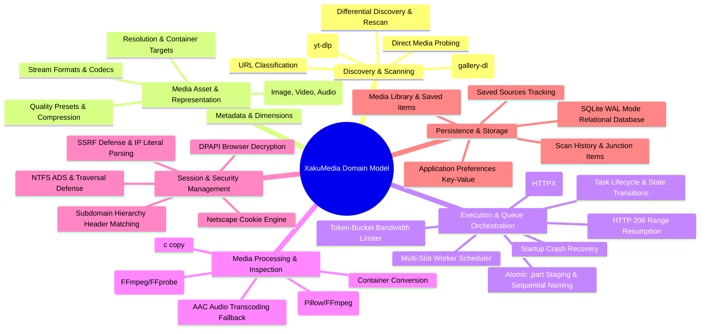
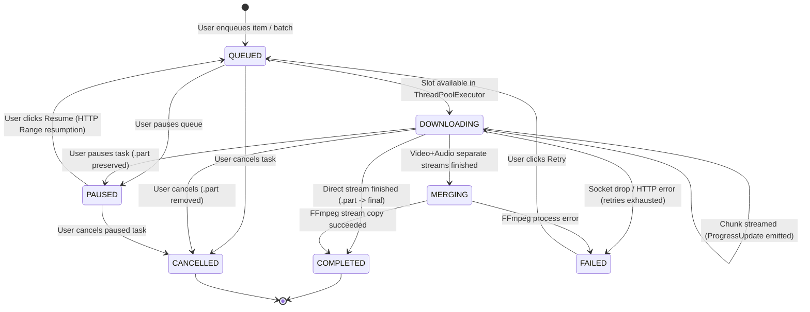
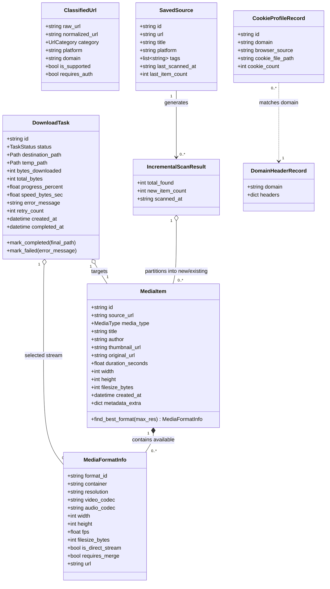
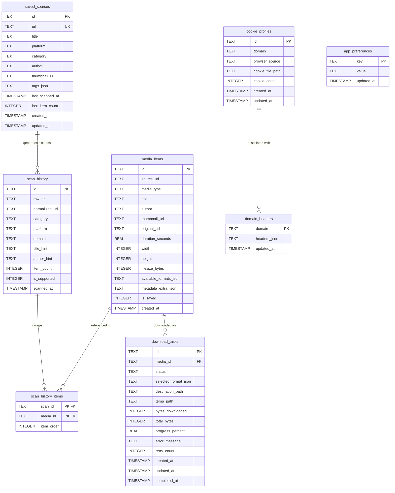

# XakuMedia — Domain Model & Ubiquitous Language

## 1. Domain Modeling Overview & Ubiquitous Language

XakuMedia's business logic is modeled around autonomous media discovery, technical format inspection, batch download orchestration, local-first persistence, and secure session credential management.

To ensure consistency across the user interface, desktop shell, Python engine, and database schema, the system adopts a unified **Ubiquitous Language**:

| Domain Term | Definition | Code Representation |
| :--- | :--- | :--- |
| **Source URL** | A public web address representing a media asset, post, album, profile, or feed provided by the user. | `ClassifiedUrl.raw_url` |
| **Classified URL** | The normalized result of probing a Source URL, annotated with its identified platform, domain, category, and authentication requirements. | `ClassifiedUrl` in `models/url.py` |
| **Media Item** | A discrete discoverable media object (image, video, or audio track) with its intrinsic attributes (dimensions, duration, size, author). | `MediaItem` in `models/media.py` |
| **Media Format Info** | Technical specifications of a particular media stream or file variant (container, resolution, FPS, video/audio codecs, download URL). | `MediaFormatInfo` in `models/media.py` |
| **Download Task** | A stateful background job representing the downloading, chunk staging, stream merging, and disk writing of a specific Media Item. | `DownloadTask` in `models/queue.py` |
| **Task Status** | The discrete lifecycle state of a Download Task (`queued`, `scanning`, `downloading`, `merging`, `completed`, `failed`, `cancelled`, `paused`). | `TaskStatus` in `models/queue.py` |
| **Progress Update** | Real-time telemetry emitted during active streaming, capturing downloaded bytes, transfer speed, percentage, and ETA. | `ProgressUpdate` in `models/queue.py` |
| **Bandwidth Throttler** | A thread-safe token bucket rate limiter regulating global byte consumption across all active worker threads. | `BandwidthThrottler` in `downloader/throttler.py` |
| **Cookie Profile** | A saved collection of session cookies associated with a specific web domain, imported from browser profiles or Netscape text files. | `CookieProfileRecord` in `auth/models.py` |
| **Domain Headers** | Custom HTTP request headers (Authorization tokens, Referer, User-Agent) mapped to specific domains or inherited hierarchically. | `DomainHeaderRecord` in `auth/models.py` |
| **Saved Source** | A bookmarked channel, creator profile, or gallery feed tracked for periodic or manual incremental rescanning. | `SavedSource` in `models/source.py` |
| **Incremental Rescan** | A differential discovery process that compares newly probed URLs against existing SQLite history to isolate new delta items. | `IncrementalScanResult` in `models/source.py` |
| **Sequential Naming** | Anti-collision file naming convention enforcing `{username}_{vdo\|img}_{sequence:03d}.{ext}` backed by physical disk scanning. | `format_sequential_filename` in `utils/naming.py` |

---

## 2. Core Business Domains & Subdomains

---

## 3. Entities, Value Objects & Domain Models

### 3.1 Media Asset Domain (`models/media.py`, `models/quality.py`)

#### `MediaItem` (Entity)
Represents a unique, identifiable media asset discovered during scanning or saved in the local media library:
- `id: str` (UUID v4 string primary key)
- `source_url: str` (The original page or collection URL where the asset was discovered)
- `media_type: MediaType` (`image`, `video`, `audio`)
- `title: str | None` (Human-readable title or post caption)
- `author: str` (Creator or platform handle; defaults to `"media"`)
- `thumbnail_url: str | None` (Remote thumbnail image URL)
- `original_url: str` (Direct URL to the full-fidelity source media stream)
- `duration_seconds: float | None` (Playback duration for video/audio assets)
- `width: int | None` (Horizontal pixel resolution)
- `height: int | None` (Vertical pixel resolution)
- `filesize_bytes: int | None` (Reported or estimated file size in bytes)
- `available_formats: list[MediaFormatInfo]` (Collection of discovered technical streams)
- `created_at: datetime` (Timestamp of initial discovery)
- `metadata_extra: dict[str, Any]` (Arbitrary platform-specific metadata tags)

#### `MediaFormatInfo` (Value Object)
Describes a specific downloadable stream or container variant for a `MediaItem`:
- `format_id: str` (Internal or platform stream identifier, e.g. `"137"`, `"mp4-1080p"`)
- `container: str | None` (Target container extension, e.g. `"mp4"`, `"webm"`, `"jpg"`)
- `resolution: str | None` (Human-readable resolution tag, e.g. `"1080p"`, `"1920x1080"`)
- `video_codec: str | None` (Video encoding format, e.g. `"avc1.640028"`, `"vp9"`, `"none"`)
- `audio_codec: str | None` (Audio encoding format, e.g. `"mp4a.40.2"`, `"opus"`, `"none"`)
- `width: int | None`, `height: int | None`, `fps: float | None`
- `filesize_bytes: int | None`
- `is_direct_stream: bool` (`True` if the stream contains both video and audio)
- `requires_merge: bool` (`True` if video stream lacks audio and requires FFmpeg multiplexing)
- `url: str | None` (Direct stream download endpoint)
- `format_note: str | None` (Quality notes, e.g. `"DASH video"`, `"1080p60"`)

#### Enums & Quality Types
- `MediaType`: `IMAGE`, `VIDEO`, `AUDIO`
- `VideoResolution`: `BEST`, `2160P` (4K), `1440P` (2K), `1080P` (FHD), `720P` (HD), `480P`, `360P`
- `VideoContainer`: `ORIGINAL`, `MP4`, `WEBM`, `MKV`
- `ImageFormat`: `ORIGINAL`, `JPG`, `PNG`, `WEBP`, `AVIF`
- `ImageQualityPreset`: `ORIGINAL`, `HIGH` (90%), `BALANCED` (80%), `COMPACT` (65%)

---

### 3.2 Download Queue & Task Execution Domain (`models/queue.py`)

#### `DownloadTask` (Entity)
Represents a persistent background download job executing through the worker pool:
- `id: str` (UUID v4 string primary key)
- `media_item: MediaItem` (The underlying asset being transferred)
- `status: TaskStatus` (Current execution state)
- `selected_format: MediaFormatInfo | None` (User-selected or auto-resolved format)
- `destination_path: Path | None` (Target disk location, e.g. `C:\Users\...\videos\artist_vdo_001.mp4`)
- `temp_path: Path | None` (Temporary download staging file with `.part` extension)
- `bytes_downloaded: int` (Bytes currently committed to disk)
- `total_bytes: int | None` (Total expected content length)
- `progress_percent: float` (Calculated percentage from `0.0` to `100.0`)
- `speed_bytes_sec: float` (Instantaneous transfer rate in bytes per second)
- `error_message: str | None` (Failure description if status is `failed`)
- `retry_count: int` (Number of automatic retry attempts)
- `created_at: datetime`, `completed_at: datetime | None`

#### `TaskStatus` (Enum with State Logic)
- `QUEUED`: Enqueued in pending FIFO queue waiting for an open worker slot.
- `SCANNING`: Performing pre-download probe or resolving dynamic stream tokens.
- `DOWNLOADING`: Active chunk streaming via HTTPX to `.part` file on disk.
- `MERGING`: Executing FFmpeg multiplexing for separate video and audio tracks.
- `COMPLETED`: Terminal state; file validated and atomically renamed to final destination.
- `FAILED`: Terminal state; transfer failed after exhausting retries.
- `CANCELLED`: Terminal state; user cancelled transfer; temporary `.part` file removed.
- `PAUSED`: User paused transfer or engine recovered crash; partial `.part` file preserved on disk for resumption.

---

### 3.3 URL Discovery & Probing Domain (`models/url.py`)

#### `ClassifiedUrl` (Value Object)
Captures the result of structural URL probing and extraction routing:
- `raw_url: str` (Original unescaped string submitted by the user)
- `normalized_url: str` (Cleaned URL with stripped tracking query params)
- `category: UrlCategory` (`direct_image`, `direct_video`, `social_post`, `gallery`, `channel`, `unknown`)
- `platform: str | None` (Identified host platform, e.g. `"youtube"`, `"reddit"`, `"direct"`)
- `domain: str | None` (Root or subdomain, e.g. `"i.redd.it"`, `"youtube.com"`)
- `author_hint: str | None` (Creator handle extracted from URL pattern)
- `title_hint: str | None` (Title or slug extracted from URL pattern)
- `is_supported: bool` (`True` if an extractor or scanner recognizes the URL)
- `requires_auth: bool` (`True` if platform requires session cookies)
- `metadata_extra: dict[str, str]`

---

### 3.4 Session Credentials & Authentication Domain (`auth/models.py`)

#### `CookieEntry` (Value Object)
Represents a parsed Netscape HTTP cookie entry:
- `domain: str`, `flag: bool` (include subdomains), `path: str`, `secure: bool`
- `expiration: int` (Unix timestamp; `0` denotes session cookie)
- `name: str`, `value: str`

#### `CookieProfileRecord` (Entity)
Persisted user session profile in SQLite:
- `id: str` (UUID v4)
- `domain: str` (Target domain, e.g. `"instagram.com"`, `"patreon.com"`)
- `browser_source: str | None` (Origin browser: `"chrome"`, `"edge"`, `"firefox"`, `"brave"`, `"file"`)
- `cookie_file_path: str` (Path to sanitized Netscape text file on disk)
- `cookie_count: int` (Number of active cookies in the file)
- `created_at: str`, `updated_at: str`

#### `DomainHeaderRecord` (Entity)
Custom HTTP request headers configured for a specific web host:
- `domain: str` (Primary key domain name)
- `headers: dict[str, str]` (Key-value map of header names and values)
- `updated_at: str`

---

### 3.5 Saved Sources & Differential Discovery Domain (`models/source.py`)

#### `SavedSource` (Entity)
Bookmarked media source for continuous tracking and differential rescanning:
- `id: str` (UUID v4)
- `url: str` (Source channel, gallery, or artist profile URL — unique)
- `title: str` (Display name)
- `platform: str | None`, `category: str | None`, `author: str | None`
- `thumbnail_url: str | None`
- `tags: list[str]` (Organizational tag strings, e.g. `["art", "nature", "reference"]`)
- `last_scanned_at: str | None` (ISO timestamp of most recent rescan)
- `last_item_count: int` (Number of total items discovered during last scan)
- `created_at: str`, `updated_at: str`

#### `IncrementalScanResult` (Value Object)
Differential scan report produced by `incremental_rescan_source`:
- `source: SavedSource` (The source being scanned)
- `total_found: int` (Total items discovered during the scan)
- `new_items: list[MediaItem]` (Subset of items that have never been scanned or downloaded)
- `existing_items: list[MediaItem]` (Subset of items already present in SQLite history)
- `new_item_count: int` (Length of `new_items`)
- `scanned_at: str`

---

## 4. Entity Relationships & Domain Class Diagram

---

## 5. Relational SQLite Schema & ERD

The physical relational schema managed by `backend/src/xakumedia/db/schema.py` (Version 4):

---

## 6. Business Rules & Domain Invariants

The following business rules are explicitly enforced across the codebase and verified through automated test suites:

### BR-1: Sequential Anti-Collision File Naming
- **Rule:** Downloaded media files must be named according to the template: `{username}_{prefix}_{sequence:03d}.{ext}`, where `prefix` is `"vdo"` for video and `"img"` for image.
- **Invariant:** Sequence numbers start at `001` and expand to 4+ digits if count $\ge 1000$. The engine inspects both SQLite task records **and** existing physical files on disk before allocating an index (`get_next_sequence_number` in `utils/naming.py`). No file on disk is ever overwritten.

### BR-2: Two-Phase Atomic Download Staging
- **Rule:** Active downloads must stream into a `.part` staging file (`{filename}.part`).
- **Invariant:** The final destination file (`{filename}`) must never be created or touched until the entire stream is successfully received, validated, and merged. Once complete, an atomic rename promotes the `.part` file. Corrupt or aborted files never masquerade as complete media.

### BR-3: Lossless Audio/Video Multiplexing
- **Rule:** When video platforms separate high-resolution video streams from audio tracks, both tracks must be downloaded independently and multiplexed using FFmpeg stream copying (`-c:v copy -c:a copy`).
- **Invariant:** Re-encoding is prohibited unless container constraints strictly require audio transcoding (e.g., Opus audio into an MP4 container, which falls back to `-c:a aac -b:a 192k`). Video frames are never re-encoded.

### BR-4: True Source Quality Fidelity
- **Rule:** The user interface must present only resolutions, codecs, and container formats that actually exist in the remote media metadata.
- **Invariant:** The application must never invent higher resolutions (e.g. upscaling 720p to 1080p), synthesize fictitious bitrates, or claim lossless conversion from compressed sources.

### BR-5: Global Bandwidth Rate Limiting
- **Rule:** The user may set a global speed limit in KB/s.
- **Invariant:** Bandwidth throttling must be enforced collectively across all active concurrent download threads using a thread-safe token bucket algorithm (`downloader/throttler.py`). Total instantaneous consumption must not exceed the configured threshold, and sleep cycles must slice under $50\text{ ms}$ to maintain responsiveness to pause and cancel events.

### BR-6: Interrupted Task Recovery & Resumption
- **Rule:** Application shutdown, crashes, or power outages must not corrupt active tasks or discard previously downloaded data.
- **Invariant:** At startup, `TaskRecoveryService` audits SQLite tasks against disk `.part` files. If a `.part` file exists, `bytes_downloaded` is synchronized to the on-disk size, the task transitions to `PAUSED`, and subsequent resumption uses HTTP `Range` headers to continue from that exact byte offset.

### BR-7: Subdomain Hierarchy Header & Cookie Matching
- **Rule:** Domain-level credentials (cookies and custom request headers) must be resolved with subdomain hierarchy fallback.
- **Invariant:** When requesting `v.redd.it`, the engine checks for exact rules for `v.redd.it`. If absent, it ascends the domain tree to `redd.it`, applying parent credentials automatically while preventing leakage to foreign domains.

### BR-8: Differential Discovery URL Set Reconciliation
- **Rule:** When rescanning a bookmarked `SavedSource`, previously discovered media items must be segregated from newly discovered items.
- **Invariant:** The engine queries SQLite history to construct an $O(1)$ set of all known URLs for that source. Probed items are strictly partitioned into `new_items` vs `existing_items`, enabling 1-click downloading of only the newly posted content.

### BR-9: Strict Security & Defense Invariants
- **Network Invariant (SSRF):** Requests must reject private IP literals (RFC 1918), loopbacks (127.0.0.0/8, ::1), carrier-grade NAT (100.64.0.0/10), link-local addresses (169.254.0.0/16), IPv6 mapped IPv4 addresses, and cloud metadata endpoints (`169.254.169.254`, `metadata.google.internal`).
- **Filesystem Invariant (Windows):** Destination paths must reject null bytes (`\0`), NTFS Alternate Data Streams (`:`), Windows DOS reserved device names (`CON`, `PRN`, `AUX`, `NUL`, `COM1-9`, `LPT1-9`), and UNC network paths (`\\server\share`).

