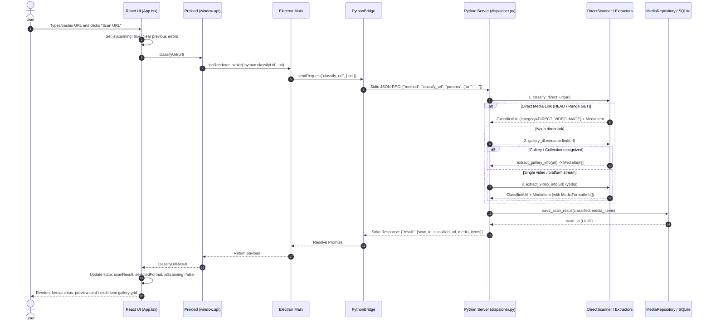
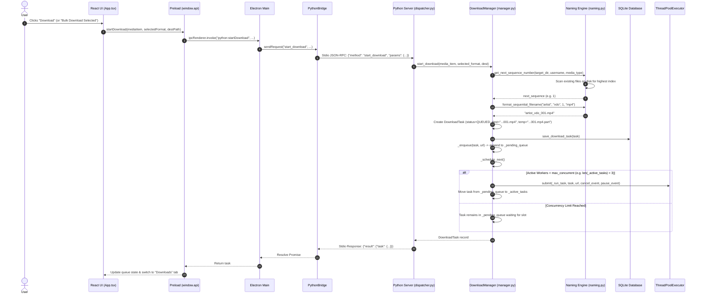
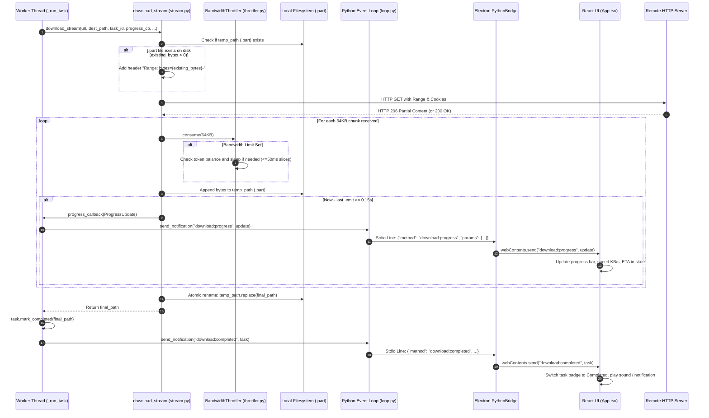
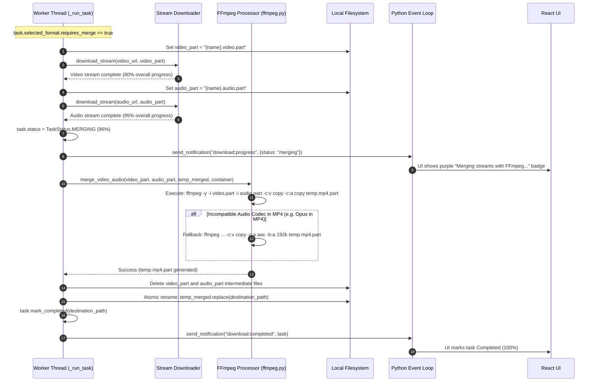
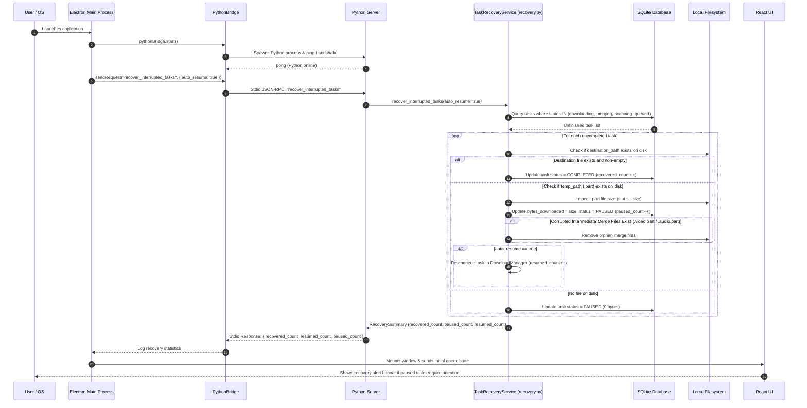
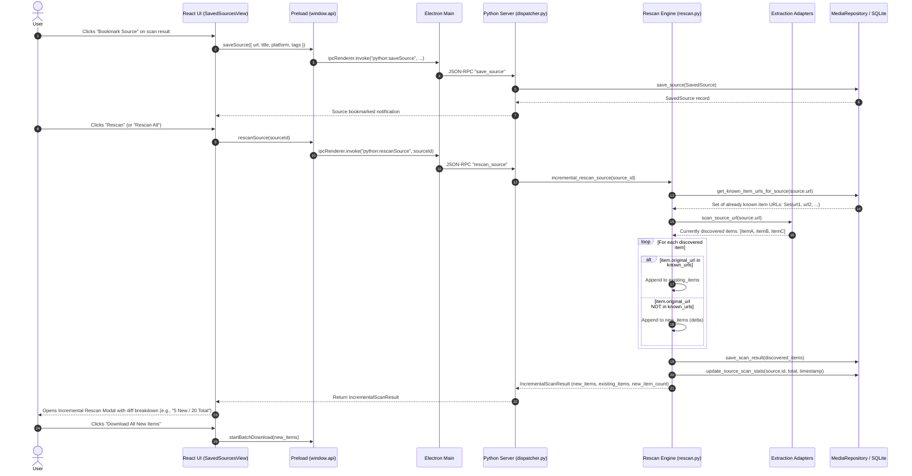
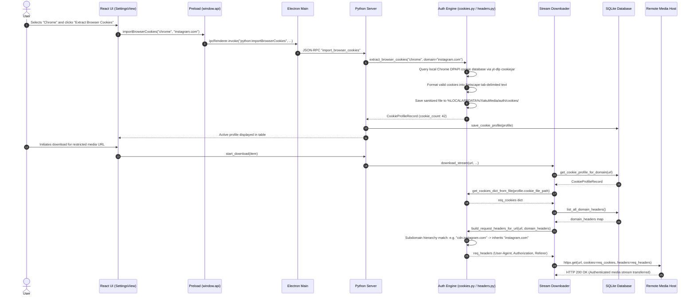
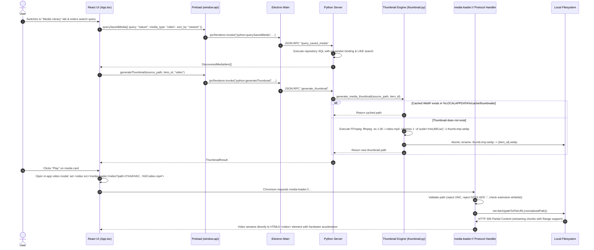
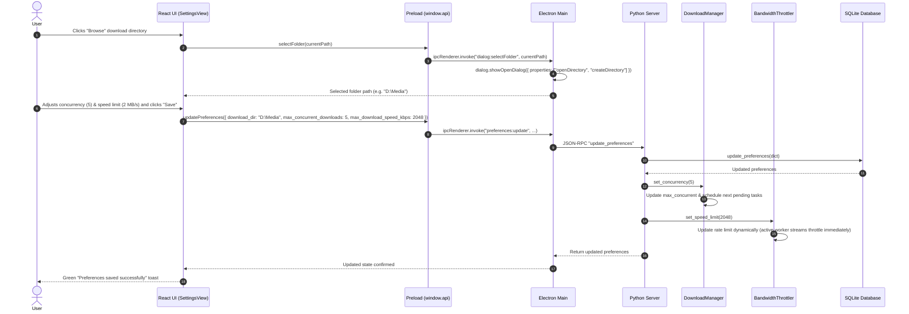
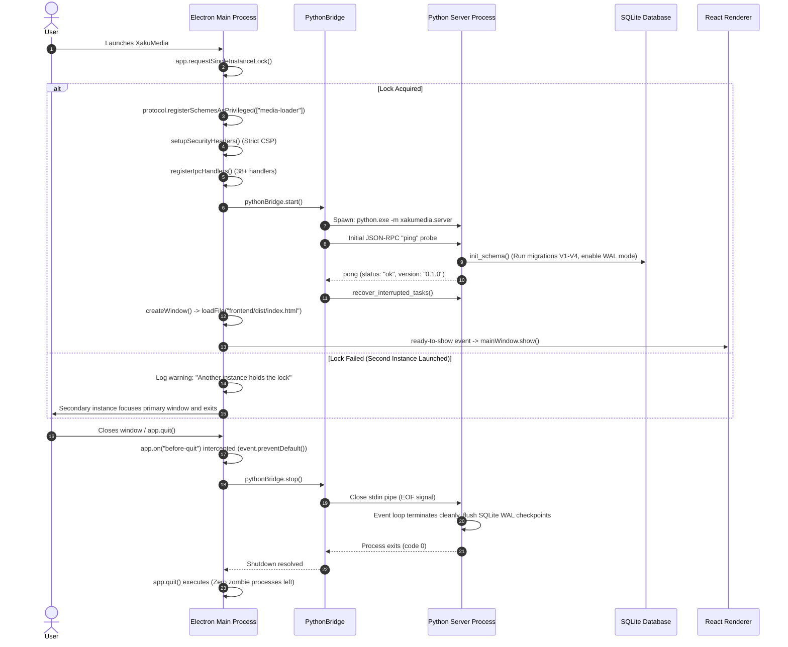

# XakuMedia — End-to-End System Flows

This document details the critical execution paths and data flows across the three tiers of XakuMedia: the **React Frontend (Renderer)**, the **Electron Main Process**, the **Python 3.12 Engine**, the **Local SQLite Database**, the **Local Filesystem**, and **Remote Media Services**.

---

## 1. Flow 1: URL Scan to Media Discovery & Presentation

Traces the user journey when submitting a URL into the Scan view.

### Key Execution Highlights:
1. **SSRF Pre-Validation (`utils/security.py`):** Before making any network request, `validate_url_security` ensures the URL does not target loopbacks (`127.0.0.1`), private RFC 1918 subnets (`10.0.0.0/8`, `192.168.0.0/16`), mapped IPv6 addresses, or cloud metadata endpoints.
2. **Adaptive Probing:** If an initial HTTP `HEAD` request returns a `403` or `405` (frequent on CDNs), `probe_direct_url` automatically falls back to an HTTP `Range: bytes=0-1024` `GET` request.
3. **Automatic Persistence:** Discovered items are immediately committed to `scan_history` and `media_items` in SQLite, ensuring scan history is preserved even if the user does not immediately download them.

---

## 2. Flow 2: Download Initiation & Worker Slot Scheduling

Traces single-item or selective bulk gallery downloads from user click to thread allocation.

---

## 3. Flow 3: Chunked Stream Download, Range Resumption & Live Telemetry

Traces active streaming over the network, bandwidth throttling, `.part` staging, and real-time UI updates.

---

## 4. Flow 4: Dual-Stream Video/Audio Download & FFmpeg Multiplexing

Traces the execution path when a video format requires separate video and audio stream merging.

---

## 5. Flow 5: Task Queue Crash Recovery & Auto-Resumption

Traces how XakuMedia recovers from unexpected power outages, crashes, or forced termination.

---

## 6. Flow 6: Saved Sources Bookmark & Incremental Rescan

Traces bookmarking a channel/gallery and periodically discovering only new media items.

---

## 7. Flow 7: Session Cookie Import & Subdomain Header Injection

Traces importing browser cookies and automatically attaching them to restricted download requests.

---

## 8. Flow 8: Media Library Search, Thumbnail Caching & `media-loader://` Playback

Traces searching saved media items, generating cached thumbnails, and streaming local video inside the renderer.

---

## 9. Flow 9: Application Settings Update & Synchronization

Traces updating user preferences and synchronizing runtime state across Python and Electron.

---

## 10. Flow 10: Application Lifecycle (Startup & Graceful Shutdown)

Traces the desktop initialization and clean exit lifecycle.

